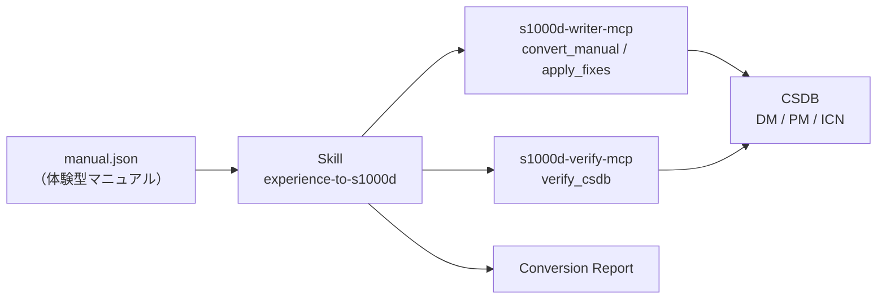

# experience-to-s1000d-skill

[English](./README.md) | **日本語**

[](./LICENSE)

体験型マニュアル（`experiential-manual-model` の JSON）を、S1000D® の CSDB（データモジュール・パブリケーションモジュール・ICN）に変換する Claude Skill です。どのツールをどの順番で呼ぶか、各段階で利用者に何を聞くかを、Claude に伝えます。

> [!IMPORTANT]
> このプロジェクトは ASD（Aerospace, Security and Defence Industries Association of Europe）とは無関係の個人プロジェクトです。S1000D® は ASD の登録商標です。
> S1000D の仕様書・XML スキーマ・既定 BREX・公式サンプルは、利用条件により再配布できないため、どのパッケージにもリポジトリにも含まれていません。s1000d.org から入手し、展開したフォルダーを環境変数 `S1000D_SPEC_DIR` で指定してください。

## 提供するもの

このリポジトリは MCP サーバーではなく Skill です。Markdown の手順書で、変換や検証の処理は持ちません。判定はすべて S1000D の MCP サーバーの応答を根拠にします。



### 原則

1. Skill は XML を書きません。XML は writer サーバーが組み立てます。
2. 判定はサーバーが下し、Skill は説明します。XSD・BREX・参照の結果と修正の候補はサーバーの応答を根拠にし、上書きしません。
3. 候補の外の値を使いません。修正は `fixes[]` の候補から選びます。`confidence: none` のときと `range` / `pattern` の候補のときは、利用者に聞きます。
4. 利用者が確認する前に書き込みません（`write: true`）。
5. 検証状態を必ず報告します。`schema-not-found` と `not-run` を合格とは書かず、S1000D への準拠は判定しません。
6. 必須の MCP サーバーが接続されていなければ、Skill は止まり、接続の方法を伝えます。

## 変換の流れ

1. マニュアルのパス、CSDB のフォルダー、機密区分を確かめます。
2. 採番の規則（モデル識別コード、システム差異コード、SNS、種類ごとの情報コード、CAGE コード）を聞きます。情報コードの既定はありません。
3. 採番の台帳の保存先を決めます（`<manual>.ledger.json` を提案します）。
4. `convert_manual` を `write: false` で実行し、データモジュールの一覧、検証状態、`notRepresented`（ホットスポットの座標など）を報告します。
5. 残った修正を片付けます。自動で直った修正は報告するだけ、候補が複数なら利用者が選び、候補が無ければ利用者に聞きます。
6. 利用者の確認の後に `write: true` で書き込み、`verify_csdb` で CSDB 全体を確かめます。
7. Conversion Report を返します。

判断の基準は `references/` にあります。[allocation.md](skills/experience-to-s1000d/references/allocation.md)（採番の規則の聞き方）、[report.md](skills/experience-to-s1000d/references/report.md)（報告の雛形）、[not-represented.md](skills/experience-to-s1000d/references/not-represented.md)（データモジュールで表せないものと伝え方）です。

## 前提の MCP サーバー

| MCP サーバー | 必須 | 最低版 | 役割 |
|---|---|---|---|
| [s1000d-writer-mcp](https://www.npmjs.com/package/@shuji-bonji/s1000d-writer-mcp) | 必須 | 0.1.1 | `convert_manual`、`apply_fixes` |
| [s1000d-verify-mcp](https://www.npmjs.com/package/@shuji-bonji/s1000d-verify-mcp) | 必須 | 0.6.1 | `verify_csdb`、`check_references` |
| [s1000d-brex-mcp](https://www.npmjs.com/package/@shuji-bonji/s1000d-brex-mcp) | 任意 | 0.4.0 | `list_notations`、`lookup_value` |
| [s1000d-reader-mcp](https://www.npmjs.com/package/@shuji-bonji/s1000d-reader-mcp) | 任意 | 0.7.1 | `read_data_module` |

`s1000d-writer-mcp` と `s1000d-verify-mcp` は `plugin.json` の `dependencies` に宣言してあります。任意のサーバーが無いときは、報告の該当項目に「未実施（ツール未接続）」と書きます。

## インストール

```bash
/plugin marketplace add shuji-bonji/claude-plugins
/plugin install s1000d-writer-mcp@shuji-bonji   # 必須
/plugin install s1000d-verify-mcp@shuji-bonji   # 必須
/plugin install experience-to-s1000d@shuji-bonji
```

Releases の `.plugin` ファイルを Cowork に追加するか、`skills/experience-to-s1000d/` を `~/.claude/skills/` にコピーしても使えます。

## ディレクトリ構成

```text
experience-to-s1000d-skill/
├── .claude-plugin/plugin.json
├── skills/experience-to-s1000d/
│   ├── SKILL.md
│   └── references/ (allocation.md, report.md, not-represented.md)
├── evals/trigger-eval.json
├── .github/workflows/release.yml
├── README.md / README.ja.md
├── CHANGELOG.md
└── LICENSE
```

> [!NOTE]
> `SKILL.md` と `references/` は日本語で書いています。Claude は会話の言語にかかわらず従います。

## ライセンス

MIT。この Skill が出すのは変換の結果と検証状態で、S1000D への準拠の判定ではありません。
