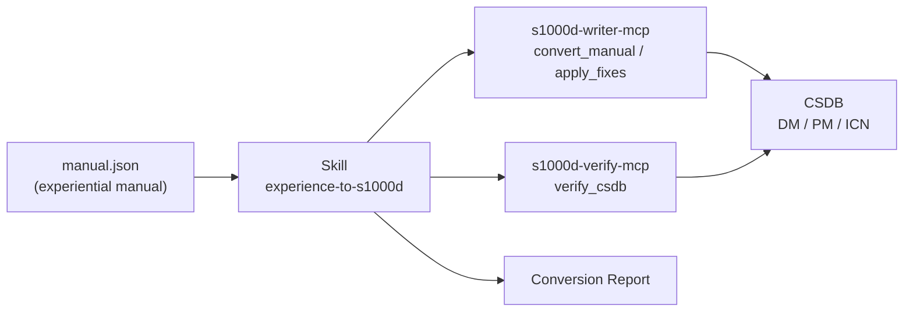

# experience-to-s1000d-skill

**English** | [日本語](./README.ja.md)

[](./LICENSE)

A Claude Skill that converts an experiential manual (an `experiential-manual-model` JSON file) into an S1000D® CSDB: data modules, a publication module and ICNs. It tells Claude which tool to call, in which order, and what to ask you at each step.

> [!IMPORTANT]
> This is a personal project and is not affiliated with ASD (Aerospace, Security and Defence Industries Association of Europe). S1000D® is a registered trademark of ASD.
> The S1000D specification, XML schemas, default BREX and official samples are not included in any package or repository, because their terms of use do not grant redistribution. Obtain them from s1000d.org and point the `S1000D_SPEC_DIR` environment variable at the extracted folder.

## What it provides

This repository is a Skill, not an MCP server. It is a Markdown playbook. It holds no conversion or validation code; every judgment comes from the responses of the S1000D MCP servers.



### Principles

1. The Skill never writes XML. The writer server builds it.
2. The servers decide; the Skill explains. XSD, BREX and reference results, and fix candidates, come from server responses and are never overridden.
3. No value outside the candidates. A fix is chosen from `fixes[]`. For `confidence: none`, or a `range` / `pattern` candidate, the Skill asks you.
4. Nothing is written before you confirm (`write: true`).
5. The verification status is always reported. `schema-not-found` and `not-run` are never reported as a pass, and S1000D conformance is not decided.
6. If a required MCP server is not connected, the Skill stops and tells you how to connect it.

## What a conversion looks like

1. Confirm the manual path, the CSDB folder and the security classification.
2. Ask for the numbering rules: model identification code, system difference code, SNS, information codes per kind, CAGE code. There is no default for information codes.
3. Decide where the numbering ledger is kept (`<manual>.ledger.json` is suggested).
4. Run `convert_manual` with `write: false` and report the data modules, the verification status and `notRepresented` (for example, hotspot coordinates).
5. Resolve the remaining fixes: automatic fixes are only reported, several candidates are chosen by you, no candidate means the Skill asks you.
6. After your confirmation, write with `write: true` and verify the whole CSDB with `verify_csdb`.
7. Return a Conversion Report.

The references hold the criteria: [allocation.md](skills/experience-to-s1000d/references/allocation.md) (how to ask for numbering rules), [report.md](skills/experience-to-s1000d/references/report.md) (the report template) and [not-represented.md](skills/experience-to-s1000d/references/not-represented.md) (what cannot be expressed in data modules, and how to tell you).

## Prerequisite MCP servers

| MCP server | Required | Minimum version | Role |
|---|---|---|---|
| [s1000d-writer-mcp](https://www.npmjs.com/package/@shuji-bonji/s1000d-writer-mcp) | Yes | 0.1.1 | `convert_manual`, `apply_fixes` |
| [s1000d-verify-mcp](https://www.npmjs.com/package/@shuji-bonji/s1000d-verify-mcp) | Yes | 0.6.1 | `verify_csdb`, `check_references` |
| [s1000d-brex-mcp](https://www.npmjs.com/package/@shuji-bonji/s1000d-brex-mcp) | No | 0.4.0 | `list_notations`, `lookup_value` |
| [s1000d-reader-mcp](https://www.npmjs.com/package/@shuji-bonji/s1000d-reader-mcp) | No | 0.7.1 | `read_data_module` |

`s1000d-writer-mcp` and `s1000d-verify-mcp` are declared in `dependencies` of `plugin.json`. Without the optional servers, the corresponding items in the report say "not performed (tool not connected)".

## Installation

```bash
/plugin marketplace add shuji-bonji/claude-plugins
/plugin install s1000d-writer-mcp@shuji-bonji   # required
/plugin install s1000d-verify-mcp@shuji-bonji   # required
/plugin install experience-to-s1000d@shuji-bonji
```

You can also download the `.plugin` file from Releases and add it in Cowork, or copy `skills/experience-to-s1000d/` to `~/.claude/skills/`.

## Directory layout

```text
experience-to-s1000d-skill/
├── .claude-plugin/plugin.json
├── skills/experience-to-s1000d/
│   ├── SKILL.md
│   └── references/ (allocation.md, report.md, not-represented.md)
├── evals/trigger-eval.json
├── .github/workflows/release.yml
├── README.md / README.ja.md
├── CHANGELOG.md
└── LICENSE
```

> [!NOTE]
> `SKILL.md` and `references/` are written in Japanese. Claude follows them regardless of the conversation language.

## License

MIT. This Skill produces conversion results and verification statuses, not statements of S1000D conformance.
